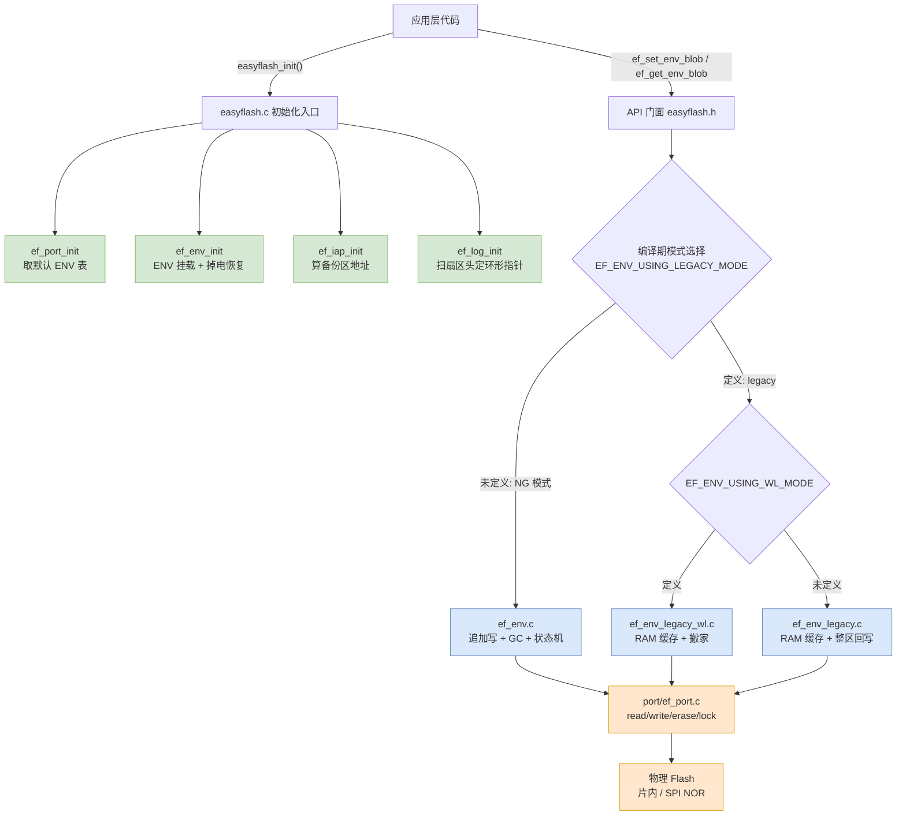
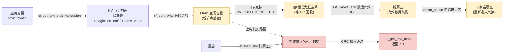

# EasyFlash 源码详解 00：总览与双模式架构

> **涉及文件**
> - `/easyflash/inc/easyflash.h`（全库唯一公共 API 头，注释后 160 行）
> - `/easyflash/inc/ef_cfg.h`（裁剪与布局配置，注释后 115 行）
> - `/easyflash/inc/ef_def.h`（公共定义：错误码/状态机/KV 对象，注释后 157 行）
> - `/easyflash/src/easyflash.c`（初始化入口，注释后 144 行）
> - `/easyflash/src/ef_env.c`（ENV NG 模式核心，1858 行，GBK 编码）
> - `/easyflash/src/ef_env_legacy.c`（legacy normal 模式，注释后 1114 行）
> - `/easyflash/src/ef_env_legacy_wl.c`（legacy 磨损均衡模式，注释后 1234 行）
> - `/easyflash/src/ef_iap.c`（IAP 在线升级，注释后 309 行）
> - `/easyflash/src/ef_log.c`（日志存储，注释后 771 行）
> - `/easyflash/src/ef_utils.c`（CRC32 工具，注释后 134 行）
> - `/easyflash/port/ef_port.c`（移植层，注释后 219 行）

EasyFlash 是 armink 的成名作：把 MCU 的裸 Flash 变成一个 **KV（Key-Value）参数数据库**，自带磨损均衡与掉电保护，另附 IAP 在线升级与 Flash 日志两个实用插件。它是 **FlashDB 的前身**——作者后来把 ENV 演进成了 FlashDB 的 KVDB 模式，并补上了 TSDB 时序数据库。因此读 EasyFlash 是"读 FlashDB 前"的最佳热身：同样的追加写/双扇区思想，代码量却只有 FlashDB 的一个零头。

---

## 1. 三大功能模块

| 功能 | 源文件 | 一句话职责 | 默认开关 |
| --- | --- | --- | --- |
| **ENV** 环境变量（KV 库） | `ef_env.c` 或 `ef_env_legacy*.c` | 产品参数掉电保存，支持任意类型 blob、磨损均衡、掉电保护 | `EF_USING_ENV`（默认开） |
| **IAP** 在线升级 | `ef_iap.c` | 备份区管理：擦备份区、分包写入、搬运到 App 区 | `EF_USING_IAP`（默认关） |
| **Log** 日志存储 | `ef_log.c` | 无文件系统下把日志当环形缓冲写在 Flash，崩溃后可回读 | `EF_USING_LOG`（默认关） |
| types 插件 | `plugins/types/ef_types.c` | 给字符串 ENV 套强类型外壳（int/float/数组/结构体，走 cJSON） | 独立编译 |

三大件由 `easyflash_init()` 统一拉起（见 [01-初始化与存储布局](01-初始化与存储布局.md)），彼此通过 `EF_START_ADDR + 各区 SIZE` 的**线性地址布局**共存于一段连续 Flash：

```text
EF_START_ADDR
+---------------------------+  <- ENV_AREA_SIZE
|  ENV 区（NG 或 legacy 模式） |
+---------------------------+  <- LOG_AREA_SIZE
|  LOG 日志区（环形扇区）      |
+---------------------------+
|  IAP 下载备份区（不固定大小）|
+---------------------------+
```

布局约束（`ef_cfg.h` 注释块原文）：所有区大小必须与 `EF_ERASE_MIN_SIZE`（最小擦除粒度）对齐。

---

## 2. ENV 的三种实现：一次演进史

EasyFlash 的 ENV 功能有 **2 代 3 份实现**，编译期二选一（`EF_ENV_USING_LEGACY_MODE` 未定义时用 NG）：

| 维度 | **NG 模式**（V4.0+，`ef_env.c`） | **legacy normal**（`ef_env_legacy.c`） | **legacy WL**（`ef_env_legacy_wl.c`） |
| --- | --- | --- | --- |
| 设计思想 | 追加写 + 双扇区 GC（同 FlashDB KVDB） | RAM 全缓存 + 整区擦写 | RAM 全缓存 + 数据段搬家 |
| RAM 占用 | **几乎为 0**（只有两张小缓存表，默认 16+4 项） | `ENV_USER_SETTING_SIZE` 全量缓存 | 同左 |
| value 类型 | 任意 blob、任意长度（memcpy 语义） | 只适合字符串（`key=value\0` 文本流） | 同左 |
| 掉电保护 | 原生（状态机 + CRC 逐节点） | 可选 PFS 双区乒乓 | 可选 PFS 双区乒乓 |
| 磨损均衡 | GC 搬运热点数据（LRU 思想） | 无（写放大最大） | 坏块搬家 + 写入点游走 |
| 写一次的开销 | 1 次节点追加（可能触发 GC） | 1 次整区擦 + 全量写回 | 1 次数据段擦 + 全量搬家 |
| Flash 限制 | 需支持逆序写（STM32L4 片内不行） | 几乎无限制 | 几乎无限制 |
| 现状 | **推荐**，FlashDB 前身 | 已弃用（DEPRECATED） | 已弃用 |

> 关于任务书提到的 **kg 用户配置模式**：早期 EasyFlash（V1/V2 时代）曾有独立的 `ef_kg.c`（key-goal 用户配置），本仓库（V4.1.99）中 **kg 模式已并入 env 体系，无独立源文件**——旧版字符串 API（`ef_get_env/ef_set_env/ef_save_env`）就是它留下的接口层，三套 env 实现都提供同名函数。所以本系列文章把 kg 相关语义合并进 ENV 各篇讲解。

### 2.1 为什么 legacy 被淘汰（量化对比）

以"修改 1 个 32 字节 KV、ENV 区 4KB"为例：

- **legacy normal**：`ef_save_env` 把整个 RAM 缓存（约 4KB）擦除后重写——写放大 = 全区大小/单条 KV ≈ 128 倍，且每改一次参数全部字节重写一遍；
- **legacy WL**：数据段整体搬家，除了全量写还可能在坏块时多搬一轮；
- **NG 模式**：只追加一个约 `20B 头 + 4B key + 32B value ≈ 56B` 的新节点，再把旧节点 4 字节状态表改成 PRE_DELETE/DELETED——写放大 ≈ 1.75 倍。

这就是 README 资源表里 `ROM: 6K bytes RAM: 0.1K bytes` 的底气所在。

---

## 3. 全库执行流架构图



三份 env 实现对外暴露**同一套字符串 API**（`ef_get_env/ef_set_env/...`），编译期由 `#if` 选择其一，应用层无感；NG 模式额外提供 blob API（`ef_get_env_blob/ef_set_env_blob`）。

---

## 4. 数据流全景

以一次典型的"写参数 → 重启 → 读回"为例：



关键认知：**数据载体始终是 Flash 上的 KV 节点**，RAM 里只存"加速查找的元数据"（NG 模式的 name-CRC 缓存表）或"全量镜像"（legacy 模式的 env_cache）。上电后的第一件事永远是**从 Flash 重建视图**，而不是信任 RAM。

---

## 5. 与 FlashDB 的演进对照

| EasyFlash (V4.1) | FlashDB | 演进点 |
| --- | --- | --- |
| `ef_env.c` NG 模式 | `fdb_kvdb.c` KVDB 模式 | 状态机扩展到 5 位状态表、新增大数据模式（跨扇区 blob） |
| `easyflash_init()` | `fdb_kvdb_init()` | 从"全局单库"变为"多实例"（一个分区一个 KVDB） |
| `ef_log.c` | TSDB（`fdb_tsdb.c`） | 日志环形存储思想演进为时序数据库（TSL 节点带时间戳） |
| `default_env_set[]` | `fdb_kvdb_ctrl` + 默认 KV 组 | 增量升级语义保留（版本号机制同源） |
| `ef_port.c` 四回调 | `fdb_port` (file/flash 模式) | 接口面收窄，加入对齐断言 |

一句话：**先读透 EasyFlash 的 ef_env.c 状态机与 GC，再去看 FlashDB 的 fdb_kvdb.c 就是"同题材续集"**。新项目请直接用 FlashDB；EasyFlash 的价值在于代码更短、注释更密，适合作为第一个通读的国产存储库。

---

## 6. 仓库目录与阅读路线

| 路径 | 内容 | 建议阅读顺序 |
| --- | --- | --- |
| `easyflash/inc/` | 3 个头文件（API/配置/定义） | ① 先读，建立 API 面 |
| `easyflash/src/easyflash.c` | 初始化入口 | ② |
| `easyflash/src/ef_env.c` | NG 核心（GBK 编码，注意编辑器编码） | ③ 主菜 |
| `easyflash/src/ef_env_legacy*.c` | legacy 对照组 | ④ 选读，理解演进 |
| `easyflash/src/ef_log.c` / `ef_iap.c` | 日志 / IAP 插件 | ⑤ |
| `easyflash/port/ef_port.c` | 移植层 | ⑥ 与移植文档同读 |
| `demo/` | 各平台 demo（stm32f10x/f4xx/RT-Thread） | 实测时参考 |
| `docs/zh/` | 官方中文文档（port/api/design） | 官方视角补充 |

---

## 7. 资源占用量化

README 给出的底线是 `ROM: 6K bytes RAM: 0.1K bytes`（NG 模式）。按源码展开，各模式的静态 RAM 明细：

| 组件 | NG 模式 | legacy normal | legacy WL |
| --- | --- | --- | --- |
| KV 缓存表 | 16 项 × 8B = 128 B | - | - |
| 扇区缓存表 | 4 项 × 8B = 32 B | - | - |
| RAM 镜像 env_cache | - | `ENV_USER_SETTING_SIZE`（如 4KB） | 同左 |
| 游标/标志/指针 | 约 20 B | 约 30 B | 约 40 B |
| **合计（4KB 参数区）** | **约 180 B** | 约 4.1 KB | 约 4.1 KB |

ROM 粗估（arm-none-gcc -Os，含 CRC 表 1KB）：NG 模式约 5~6KB，legacy 模式约 4~5KB（无 GC 状态机），types 插件若启用再 +8~12KB（cJSON 大头）。

栈深度方面：NG 模式最深调用链 `ef_set_env_blob → set_env → create_env_blob` 局部变量约 100~150B（env_hdr + 32B 搬运缓冲 + 扇区元数据），加上 port 层开销，**预留 512B 栈**可安全覆盖全部 API；`read_env` 用 32B 缓冲分段算 CRC 正是为压栈深。

## 8. 陷阱与读码提示

1. **`ef_env.c` 是 GBK 编码**：VSCode 需手动选 GBK/GB2312 打开，否则中文注释乱码；其余文件为 UTF-8/ASCII。
2. **三套实现互斥**：同时编进去会符号冲突（`ef_set_env` 重复定义），靠 `#if defined(EF_USING_ENV) && ...` 宏墙隔离。
3. **`ef_save_env` 的语义漂移**：legacy 模式它是"延迟写"的落盘动作；NG 模式里它是空函数——老代码迁移到 V4.0 后行为自动变化（变即时写），这正是 DEPRECATED 的原因。
4. **写粒度决定一切对齐**：`EF_WRITE_GRAN=1/8/32` 三种 Flash 的状态表大小、节点对齐全由它推导，改配置前先读 [05-移植层](05-移植层.md)。
5. `EfSecrorStatus` 的 "Secror" 是原作者拼写笔误（Sector），符号已发布无法改名，仅作记录。

---

## 9. 读码路径小结

```text
easyflash_init (easyflash.c)
  └─ ef_env_init (ef_env.c)          # 挂载：断言 -> load_env 恢复 -> auto_update
       ├─ ef_load_env                 # 扇区头检查 + GC 恢复 + KV 恢复（04 篇主角）
       │    ├─ sector_iterator / read_sector_meta_data
       │    ├─ check_and_recovery_env_cb -> move_env
       │    └─ gc_collect -> do_gc -> format_sector
       ├─ ef_get_env_blob -> find_env  # 读路径（02 篇主角）
       │    ├─ env_cache 命中 -> read_env
       │    └─ env_iterator 全扫 -> find_env_cb
       └─ ef_set_env_blob -> set_env   # 写路径（02 篇主角）
            ├─ new_env_by_kv -> alloc_env -> (gc_request)
            ├─ del_env(PRE_DELETE) -> create_env_blob -> del_env(DELETED)
            └─ gc_collect（写后检查）
```

下一篇 [01-初始化与存储布局](01-初始化与存储布局.md) 从 `easyflash_init` 一步步走进 Flash 的字节布局。
