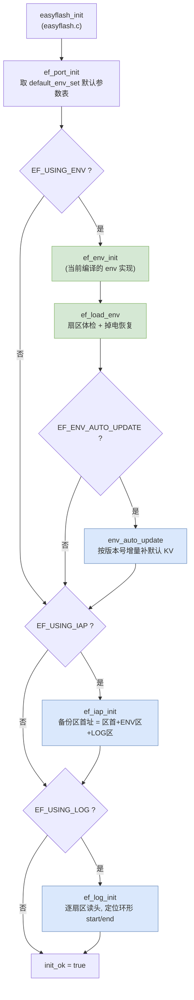
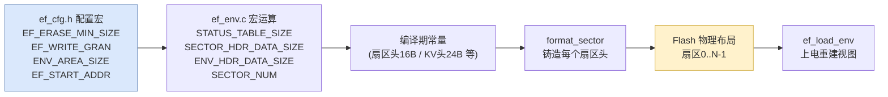

# EasyFlash 源码详解 01：初始化与存储布局

> **涉及文件**
> - `/easyflash/src/easyflash.c`（初始化入口）
> - `/easyflash/src/ef_env.c`（NG 模式布局定义，L60-149 宏区、L169-215 结构体、L1808 `ef_env_init`）
> - `/easyflash/src/ef_env_legacy.c` / `ef_env_legacy_wl.c`（legacy 布局对照）
> - `/easyflash/inc/ef_cfg.h`（所有布局宏）

---

## 1. 初始化调用链



初始化入口 `easyflash.c`（注释后 `easyflash_init` 在 L96，全文件 144 行）用静态 `init_ok` 标志保证幂等，失败短路——任何一个子模块失败，后续模块不再初始化。最重的一步是 `ef_env_init`（断言链 + 读 Flash 恢复），IAP 只是算术，LOG 要扫全扇区头。

### 1.1 ef_env_init 的断言链（ef_env.c L1815-1822）

```c
    EF_ASSERT(default_env);
    EF_ASSERT(ENV_AREA_SIZE);
    /* must be aligned with erase_min_size */
    EF_ASSERT(ENV_AREA_SIZE % EF_ERASE_MIN_SIZE == 0);
    /* sector number must be greater than or equal to 2 */
    EF_ASSERT(SECTOR_NUM >= 2);
    /* must be aligned with write granularity */
    EF_ASSERT((EF_STR_ENV_VALUE_MAX_SIZE * 8) % EF_WRITE_GRAN == 0);
```

四条断言翻译成人话：

1. 默认参数表必须存在（`ef_port.c` 里不许是空的空表还给 `default_env_size=0`）；
2. `ENV_AREA_SIZE` 必须是扇区整数倍；
3. **至少 2 个扇区**（`SECTOR_NUM = ENV_AREA_SIZE / EF_ERASE_MIN_SIZE`）——GC 需要 1 个空扇区周转，这是硬下限；
4. 字符串缓冲上限也要匹配写粒度（保证截断读取不会撕裂写粒度单元）。

---

## 2. 两个魔法字

`ef_env.c` L60-62：

```c
/* magic word(`E`, `F`, `4`, `0`) */
#define SECTOR_MAGIC_WORD                        0x30344645
/* magic word(`K`, `V`, `4`, `0`) */
#define ENV_MAGIC_WORD                           0x3034564B
```

注意字节序：`0x30344645` 在小端 Flash 上按地址读出来正是 `'E','F','4','0'`（ASCII "EF40"），KV 节点同理是 "KV40"。magic 的作用是**扇区/节点身份证明**：上电扫描时，没有 magic 的区域一律视为未格式化。

---

## 3. NG 模式存储布局（ef_env.c）

### 3.1 扇区头 `struct sector_hdr_data`（L169-177）

```c
struct sector_hdr_data {
    struct {
        uint8_t store[STORE_STATUS_TABLE_SIZE];  /**< sector store status @see sector_store_status_t */
        uint8_t dirty[DIRTY_STATUS_TABLE_SIZE];  /**< sector dirty status @see sector_dirty_status_t */
    } status_table;
    uint32_t magic;                              /**< magic word(`E`, `F`, `4`, `0`) */
    uint32_t combined;                           /**< the combined next sector number, 0xFFFFFFFF: not combined */
    uint32_t reserved;
};
```

### 3.2 KV 节点头 `struct env_hdr_data`（L194-201）

```c
struct env_hdr_data {
    uint8_t status_table[ENV_STATUS_TABLE_SIZE]; /**< ENV node status, @see node_status_t */
    uint32_t magic;                              /**< magic word(`K`, `V`, `4`, `0`) */
    uint32_t len;                                /**< ENV node total length (header + name + value), must align by EF_WRITE_GRAN */
    uint32_t crc32;                              /**< ENV node crc32(name_len + data_len + name + value) */
    uint8_t name_len;                            /**< name length */
    uint32_t value_len;                          /**< value length */
};
```

一条 KV 节点在 Flash 上的完整形态：

```text
|-- ENV_HDR_DATA_SIZE --|          |-- 对齐到写粒度 --|   |-- 对齐到写粒度 --|
+-----------------------+----------+------------------+---+----------------+
| status_table | magic(KV40) | len | crc32 | name_len | value_len | name | value |
+-----------------------+----------+------------------+---+----------------+
0                     ENV_MAGIC_OFFSET                                    节点末尾
```

CRC32 覆盖范围 = `name_len 起到 value 末尾`（含两段的对齐填充字节 0xFF），见 `create_env_blob` L1353-1363 的四段累加。

### 3.3 状态表大小速查（STATUS_TABLE_SIZE，L121-125）

状态表利用了 Flash "只能 1→0" 的物理特性：**每前进一个状态就多写一格 0**，读状态 = 数最后一个 0 的位置。

| EF_WRITE_GRAN | 公式 | 扇区 store 表（4 态） | 扇区 dirty 表（4 态） | KV 状态表（7 态） |
| --- | --- | --- | --- | --- |
| 1 bit（NOR） | `(n*1+7)/8` | 1 B | 1 B | 1 B |
| 8 bit（stm32f4） | `((n-1)*8+7)/8` | 3 B | 3 B | 6 B |
| 32 bit（stm32f1） | `((n-1)*32+7)/8` | 12 B | 12 B | 24 B |

### 3.4 头部实际字节数（典型 ARM 布局，成员 4 字节对齐）

以 **NOR（gran=1）** 为例：

- `sector_hdr_data`：store[1]+dirty[1] 补齐到 magic 的 4 字节边界 → `2+2(填)+4+4+4 = 16 B`，`SECTOR_HDR_DATA_SIZE=16`；
- `env_hdr_data`：status_table[1]+3(填)+4+4+4+name_len[1]+3(填)+4 = 24 B，`ENV_HDR_DATA_SIZE=24`；
  - `ENV_MAGIC_OFFSET=4`、`ENV_LEN_OFFSET=8`、`ENV_NAME_LEN_OFFSET=16`（L145-147 用 `offsetof` 技巧在编译期求出）。

一个 4KB 扇区的容量：`4096 - 16(头) = 4080 B` 可放 KV；一条 `wifi_ssid=mywifi`（9+6）的节点实际占 `24 + 12 + 16 = 52 B`（name/value 各自按写粒度对齐）。

### 3.5 扇区状态双轴模型

NG 模式的扇区有**两个独立状态轴**（L151-167 两个 enum）：

- **store 轴**：`UNUSED → EMPTY → USING → FULL`（物理写满进度）；
- **dirty 轴**：`UNUSED → FALSE → TRUE → GC`（垃圾比例，TRUE 才有回收价值，GC 标记 GC）。

`format_sector`（L953-979）是布局的"铸造车间"：擦整扇区后写回全 0xFF 的头，再把 store 置 EMPTY、dirty 置 FALSE、写入 magic 与 combined：

```c
        memset(&sec_hdr, 0xFF, sizeof(struct sector_hdr_data));
        set_status(sec_hdr.status_table.store, SECTOR_STORE_STATUS_NUM, SECTOR_STORE_EMPTY);
        set_status(sec_hdr.status_table.dirty, SECTOR_DIRTY_STATUS_NUM, SECTOR_DIRTY_FALSE);
        sec_hdr.magic = SECTOR_MAGIC_WORD;
        sec_hdr.combined = combined_value;
        sec_hdr.reserved = 0xFFFFFFFF;
        /* save the header */
        result = ef_port_write(addr, (uint32_t *)&sec_hdr, sizeof(struct sector_hdr_data));
```

---

## 4. legacy 模式布局对照

### 4.1 legacy normal（ef_env_legacy.c）

```text
ENV_AREA_SIZE
+------------------+-------------------------------------+
| 系统区(4字=16B起) |  数据段: "k1=v1\0pad\0k2=v2\0pad\0..." |
+------------------+-------------------------------------+
  字0: ENV 结束地址(游标)
  字1: 保存计数(仅PFS)
  字2: 版本号(仅AUTO_UPDATE)
  字尾: 数据段CRC32
```

整个 ENV 区就是**一份 RAM 镜像的落盘拷贝**：`env_cache[]`（RAM）与 Flash 一一对应，`ef_save_env` 擦整区后整块写回。PFS 模式下对半分两个区乒乓，靠 saved_count 仲裁新旧。

### 4.2 legacy WL（ef_env_legacy_wl.c）

```text
ENV_AREA_SIZE
+------------------+------------------------------------------+
| 系统扇区(1个)     |  数据段（可搬家）                          |
| 只存1个字:        |  参数区(4字) + "key=value\0"详情区          |
| cur_using_data_  |  <---- cur_using_data_addr 指向这里        |
| addr             |                                          |
+------------------+------------------------------------------+
```

关键差异：**数据段起始地址不固定**，存在系统扇区那一个字里。擦写失败时数据段向后搬一个扇区（见 [03-GC 与磨损均衡](03-GC与磨损均衡.md)），这就是软件磨损均衡。

---

## 5. 从配置宏到字节布局的数据流



所有布局常量都是宏运算的编译期结果，**运行期为零计算**；代价是改配置必须重编译。

---

## 6. 初始化实测要点

1. `easyflash_init` 返回非 0 先查三件事：`EF_START_ADDR` 是否落在合法 Flash 区间、`ENV_AREA_SIZE >= 2*EF_ERASE_MIN_SIZE`、默认表是否非空；
2. 首次上电 `ef_load_env` 会走"全扇区 magic 校验失败 → `ef_env_set_default`"路径，串口会打印 `All sector header check failed`，这是**正常的首次格式化**，不是故障；
3. NG 模式初始化耗时 ≈ 全区扇区数 × 读一个扇区头（16B/扇区）的时间，4MB NOR（1024 扇区）约毫秒级；开启 `EF_ENV_USING_CACHE` 后同参数重复初始化更快（缓存表免扫描）；
4. 初始化后立刻 `ef_print_env()` 应能看到 default_env_set 里的全部 KV，`mode: next generation`。

下一篇 [02-环境变量读写全流程](02-环境变量读写全流程.md) 深入 set/get 的每一次 Flash 触碰。
