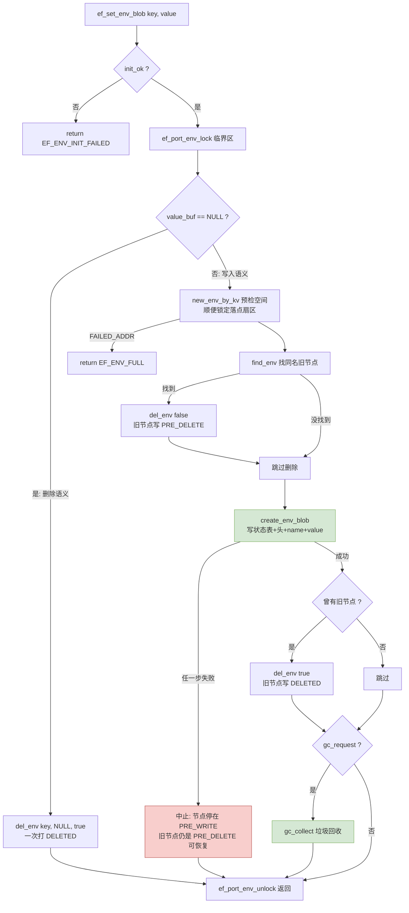
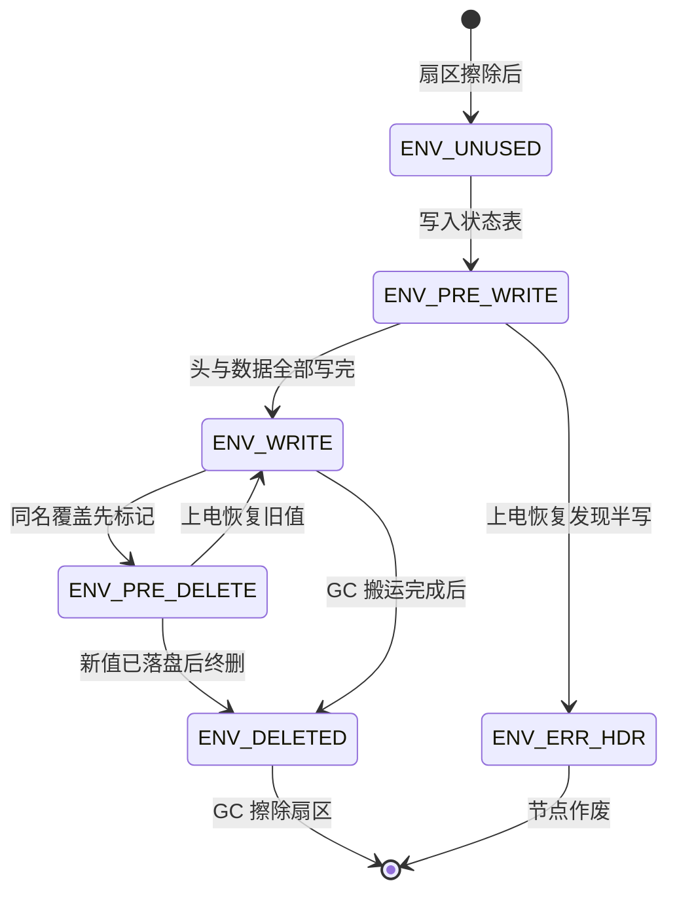
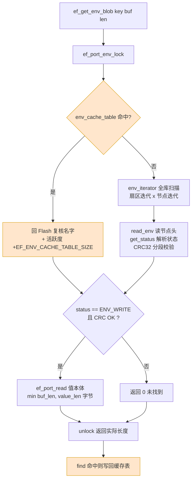
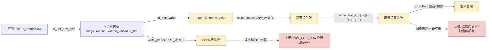

# EasyFlash 源码详解 02：环境变量读写全流程

> **涉及文件**
> - `/easyflash/src/ef_env.c`（NG 模式 set/get 主线，本文主角）
> - `/easyflash/inc/ef_def.h`（`enum env_status` L122、`struct env_node_obj` L138）
> - `/easyflash/src/ef_env_legacy.c`（legacy normal 对照，注释后行号：`ef_set_env` L616）
> - `/easyflash/src/ef_env_legacy_wl.c`（legacy WL 对照，`ef_set_env` L592）

> 行号说明：`ef_env.c` 保持原始行号（本文引用处未做注释改动，GBK 文件）；legacy 两文件行号为注释后工作区行号。

---

## 1. 写路径全景：`ef_set_env_blob` 的九步流水线

对外 API `ef_set_env_blob(key, value_buf, buf_len)`（L1489-1508）只做三件事：init 检查 → 加锁 → 调静态核心 `set_env()`。真正的逻辑在 `set_env`（L1443-1477）：

```c
static EfErrCode set_env(const char *key, const void *value_buf, size_t buf_len)
{
    EfErrCode result = EF_NO_ERR;
    static struct env_node_obj env;
    static struct sector_meta_data sector;
    bool env_is_found = false;

    if (value_buf == NULL) {
        result = del_env(key, NULL, true);
    } else {
        /* make sure the flash has enough space */
        if (new_env_by_kv(&sector, strlen(key), buf_len) == FAILED_ADDR) {
            return EF_ENV_FULL;
        }
        env_is_found = find_env(key, &env);
        /* prepare to delete the old ENV */
        if (env_is_found) {
            result = del_env(key, &env, false);
        }
        /* create the new ENV */
        if (result == EF_NO_ERR) {
            result = create_env_blob(&sector, key, value_buf, buf_len);
        }
        /* delete the old ENV */
        if (env_is_found && result == EF_NO_ERR) {
            result = del_env(key, &env, true);
        }
        /* process the GC after set ENV */
        if (gc_request) {
            gc_collect();
        }
    }

    return result;
}
```

这就是**同名覆盖**的完整剧本（以"改 `temp` 从 123 到 456"为例）：

| 步骤 | 函数 | Flash 动作 | 掉电后果（详见 04 篇） |
| --- | --- | --- | --- |
| 0 | `new_env_by_kv` | 只读：预检空间，锁定目标扇区 | 无损 |
| 1 | `find_env` | 只读：定位旧 `temp` 节点 | 无损 |
| 2 | `del_env(..., false)` | 旧节点状态写为 **PRE_DELETE** | 旧值仍有效，可恢复 |
| 3 | `create_env_blob` | 追加新节点（PRE_WRITE → **WRITE**） | 新旧并存，旧值可用 |
| 4 | `del_env(..., true)` | 旧节点状态写为 **DELETED** | 覆盖完成，不可逆 |
| 5 | `gc_collect`（如有 `gc_request`） | 搬运有效 KV、擦脏扇区 | 中断可续（04 篇） |

设计意图非常清晰：**先把新值落地成功，再杀死旧值**。任何时刻掉电，Flash 上至少有一份完整可用的 `temp`——要么旧值（新值没写完），要么新值（旧值还没标删）。

### 1.1 执行流图



### 1.2 `create_env_blob`：一次节点追加的微观时序（L1321-1399）

头部构造（L1333-1342）：

```c
    memset(&env_hdr, 0xFF, sizeof(struct env_hdr_data));
    env_hdr.magic = ENV_MAGIC_WORD;
    env_hdr.name_len = strlen(key);
    env_hdr.value_len = len;
    env_hdr.len = ENV_HDR_DATA_SIZE + EF_WG_ALIGN(env_hdr.name_len) + EF_WG_ALIGN(env_hdr.value_len);

    if (env_hdr.len > SECTOR_SIZE - SECTOR_HDR_DATA_SIZE) {
        EF_INFO("Error: The ENV size is too big\n");
        return EF_ENV_FULL;
    }
```

注意两个边界：节点总长按写粒度对齐；**单节点不允许跨扇区**（超过扇区容量直接拒绝——README 里"大数据跨扇区存储"是 V4.2 规划，本版本未实现）。

落盘五连（顺序即安全序，L1364-1388）：

```c
            /* write ENV header data */
            result = write_env_hdr(env_addr, &env_hdr);
        }
        /* write key name */
        if (result == EF_NO_ERR) {
            result = align_write(env_addr + ENV_HDR_DATA_SIZE, (uint32_t *) key, env_hdr.name_len);
            /* ... 缓存表更新（EF_ENV_USING_CACHE）省略 ... */
        }
        /* write value */
        if (result == EF_NO_ERR) {
            result = align_write(env_addr + ENV_HDR_DATA_SIZE + EF_WG_ALIGN(env_hdr.name_len), value,
                    env_hdr.value_len);
        }
        /* change the ENV status to ENV_WRITE */
        if (result == EF_NO_ERR) {
            result = write_status(env_addr, env_hdr.status_table, ENV_STATUS_NUM, ENV_WRITE);
        }
```

1. `write_env_hdr`：先写状态表（PRE_WRITE 格），再写 magic/len/crc32/name_len/value_len；
2. `align_write` 写 name（不足写粒度的尾巴用 0xFF 补齐整单元，L1291-1319）；
3. `align_write` 写 value；
4. **最后才把状态推进到 WRITE**——此前的节点在扫描者眼里都是"未完成"，不会被读到；
5. 扇区写满则置 `gc_request`，由调用方收尾时统一 GC（L1390-1393）。

### 1.3 删除的两种深度：`del_env`（L1086-1139）

```c
    /* change and save the new status */
    if (!complete_del) {
        result = write_status(old_env->addr.start, status_table, ENV_STATUS_NUM, ENV_PRE_DELETE);
        last_is_complete_del = true;
    } else {
        result = write_status(old_env->addr.start, status_table, ENV_STATUS_NUM, ENV_DELETED);
        /* ... 命中 complete_del 时顺带失效 KV 缓存（EF_ENV_USING_CACHE）省略 ... */
    }
```

删除 = **只写 4~24 字节的状态表**（推进一格状态），数据本体原封不动留在 Flash 成为"垃圾"，等 GC 物理回收。`complete_del=false` 是"留活口"（覆盖流程中间态），`true` 是终局删除。此外还会顺手把所在扇区的 dirty 轴推到 TRUE（L1131-1136），让 GC 优先盯上它。

---

## 2. KV 节点状态机

`ef_def.h` L122-130 定义 6 态 + 总数，状态表按写粒度逐格清 0（只进不退）：



读端只认 `ENV_WRITE`（`find_env_cb` L737 的判据 `env->crc_is_ok && env->status == ENV_WRITE`），其余状态在逻辑上等于不存在——这就是"追加写 + 状态门闩"的掉电安全模型。

---

## 3. 读路径全景：`ef_get_env_blob`

API（L852-870）同样是"锁 + 转发"，核心在 `get_env`（L790-812）：

```c
static size_t get_env(const char *key, void *value_buf, size_t buf_len, size_t *value_len)
{
    struct env_node_obj env;
    size_t read_len = 0;

    if (find_env(key, &env)) {
        if (value_len) {
            *value_len = env.value_len;
        }
        if (buf_len > env.value_len) {
            read_len = env.value_len;
        } else {
            read_len = buf_len;
        }
        if (value_buf){
            ef_port_read(env.addr.value, (uint32_t *) value_buf, read_len);
        }
    } else if (value_len) {
        *value_len = 0;
    }

    return read_len;
}
```

三个契约值得记住：

1. **`value_buf` 可传 NULL**：只查长度（先探大小再分配缓冲的两段式用法）；
2. **缓冲小于值长 → 截断读**，返回实际读到的字节数，不报错；`saved_value_len` 出参告诉你 Flash 上的真实长度；
3. 返回 0 = 没找到（或值为 0 长度，用 `saved_value_len` 区分）。

### 3.1 查找：缓存优先，全扫兜底

`find_env`（L753-775）的两级策略：

```c
static bool find_env(const char *key, env_node_obj_t env)
{
    bool find_ok = false;

#ifdef EF_ENV_USING_CACHE
    size_t key_len = strlen(key);

    if (get_env_from_cache(key, key_len, &env->addr.start)) {
        read_env(env);
        return true;
    }
#endif /* EF_ENV_USING_CACHE */

    find_ok = find_env_no_cache(key, env);
    ...
}
```

- **第一级**：`env_cache_table`（默认 16 项）以 name-CRC16 高 16 位为索引缓存节点地址；命中后还要回 Flash 复核名字（防 CRC 碰撞，L413-436），顺带做 LRU 式活跃度老化；
- **第二级**：`env_iterator` 全库扫描——扇区迭代器 × 节点迭代器两级嵌套（L697-725），命中即通过回调短路返回。

量化：16 项缓存命中时 1 次读（复核 32B 名字 + 读头）；未命中时最坏 O(扇区数 × 每扇区 KV 数) 次 `read_env`。对"高频读少数几个参数"的典型场景（如每秒读 WiFi 配置），缓存把平均读延迟压到 1 次小读。

### 3.2 读路径执行流



---

## 4. legacy 模式的读写对照

legacy（normal/WL 共用同一套字符串 API）的 `ef_set_env` 是完全不同的心智模型——**改 RAM，不碰 Flash**（`ef_env_legacy.c` 注释后 L616，摘录 L626-648）：

```c
    ef_port_env_lock();

    /* if ENV value is NULL, delete it */
    if (value == NULL) {
        result = del_env(key); /* 约定：set(key, NULL) = del(key)，兼容旧 API 习惯 */
    } else {
        old_env = find_env(key);
        /* If find this ENV, then compare the new value and old value. */
        if (old_env) {
            /* find the old value address */
            old_env = strchr(old_env, '='); /* 定位 '=' 后即是旧值首字符 */
            old_value = old_env + 1;
            /* If it is changed then delete it and recreate it  */
            if (strcmp(old_value, value)) { /* 值相同则不写：Flash 擦写寿命宝贵 */
                result = del_env(key);
                if (result == EF_NO_ERR) {
                    result = create_env(key, value); /* 删旧建新，新记录追加到数据段尾部 */
                }
            }
        } else {
            result = create_env(key, value);
        }
    }
```

同名覆盖 = `del_env`（RAM 内 memmove 补洞）+ `create_env`（追加到数据段尾部）；**同值 no-op** 省掉一次整区擦写。直到显式调用 `ef_save_env` 才把整个 RAM 镜像"擦区重写"落盘——这就是任务书所说 **save 延迟写**语义的源头（NG 模式删掉了这个概念：每次 set 即时落盘，`ef_save_env` 退化为空函数）。

读写两模式对比表：

| 行为 | NG 模式（ef_env.c） | legacy 模式（ef_env_legacy*.c） |
| --- | --- | --- |
| set 即时性 | 即时落盘（先写新后删旧） | 只改 RAM，`ef_save_env` 才落盘 |
| 同名覆盖 | 旧节点 PRE_DELETE→新节点→旧节点 DELETED | RAM 补洞 + 尾部追加，save 时统一生效 |
| 值类型 | 任意 blob | 仅字符串（`key=value\0`） |
| 读返回 | 拷贝到用户 buf | 返回 RAM 指针（零拷贝但会失效） |
| 删除成本 | 写一次状态表（几字节） | RAM memmove + save 时整区擦写 |

---

## 5. 一次 set 的数据流



---

## 6. 陷阱与实测建议

1. **key 长度上限 31 字节**（`EF_ENV_NAME_MAX=32` 含结尾），超长 set 返回 `EF_ENV_NAME_ERR`；
2. **key 不能含 `=`**：NG 模式不做此限制（blob 语义），但 legacy 与 types 插件按 `key=value` 解析会出乱子；跨模式通用的参数命名建议直接避开；
3. **`ef_get_env`（字符串版）在 NG 模式有 128B 截断**（`EF_STR_ENV_VALUE_MAX_SIZE`），且值必须全可打印字符，二进制值请用 `ef_get_env_blob`；
4. 同值 set 是 no-op，**不会触发写**——拿它当"心跳写"的话 Flash 上看不到任何动静；
5. `set_env` 里的 `env/sector` 是 `static` 局部变量：省栈但意味着**多任务同时 set/get 需要靠 `ef_port_env_lock` 串行化**，移植层锁不能省；
6. 删除不释放空间（只是标 DELETED），空间真正回来要等 GC——存储密集型场景请监控 `ef_print_env` 的 size 与 03 篇的 GC 触发条件。

下一篇 [03-GC 与磨损均衡](03-GC与磨损均衡.md) 拆解垃圾如何变回干净扇区。
