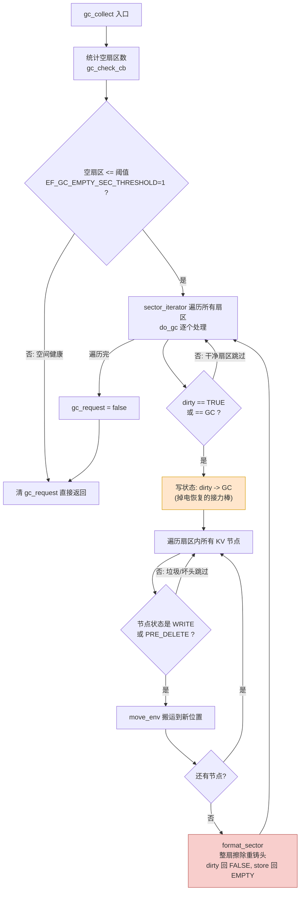
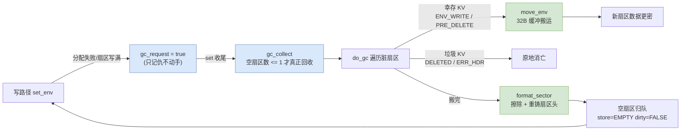

# EasyFlash 源码详解 03：GC 与磨损均衡

> **涉及文件**
> - `/easyflash/src/ef_env.c`（NG 模式 GC 状态机：`alloc_env` L1062 / `do_gc` L1243 / `gc_collect` L1274 / `move_env` L1144）
> - `/easyflash/src/ef_env_legacy_wl.c`（legacy 磨损均衡：坏块搬家，注释后 `ef_save_env` L936）
> - `/easyflash/src/ef_env_legacy.c`（PFS 双区乒乓对照，注释后 `ef_save_env` L920）

---

## 1. 为什么需要 GC

Flash 只能"1 写成 0、擦除才回 1"，删除 KV 只是把它标记为 DELETED（数据还在）。随着 set 次数增加，扇区里垃圾越积越多，**必须把幸存 KV 搬到别处、整扇区擦除**，空间才真正回来——这就是 GC。EasyFlash NG 模式的 GC 有三个鲜明特征：

1. **惰性触发**：不是后台线程，而是在写路径里"顺路"做（分配失败时、扇区写满时）；
2. **扇区粒度**：一次回收一整个扇区，搬出其中所有幸存 KV；
3. **状态机可续**：GC 中途掉电，上电看到 `SECTOR_DIRTY_GC` 标记可以接着做（04 篇）。

## 2. GC 触发条件（源码注释也给出了答案）

`ef_env.c` L1269-1273 的原文注释：

```c
/*
 * The GC will be triggered on the following scene:
 * 1. alloc an ENV when the flash not has enough space
 * 2. write an ENV then the flash not has enough space
 */
static void gc_collect(void)
```

实际代码里有**三处点火点**：

| 触发点 | 位置 | 场景 |
| --- | --- | --- |
| `alloc_env` 分配失败且空扇区不足 | L1073-1080 | 写新 KV 时，只剩 ≤ `EF_GC_EMPTY_SEC_THRESHOLD`（默认 1）个空扇区，先置 `gc_request=true` 不当场 GC |
| `create_env_blob` 写完后扇区满 | L1390-1393 | 本扇区被写满转 FULL，置 `gc_request=true` |
| `set_env` 收尾统一执行 | L1471-1473 | `gc_request` 为真则调 `gc_collect()`，**把 GC 挪到写完之后**，避免打断一次写入 |

延迟到收尾再 GC 是刻意的：分配时先"记仇"（gc_request），保证单次 set 的关键路径（写 KV）不被一次可能数秒的擦除打断。

## 3. 分配器：GC 感知的 `alloc_env`

分配回调（L1044-1060）写明了三条铁律：

```c
static bool alloc_env_cb(sector_meta_data_t sector, void *arg1, void *arg2)
{
    size_t *env_size = arg1;
    uint32_t *empty_env = arg2;

    /* 1. sector has space
     * 2. the NO dirty sector
     * 3. the dirty sector only when the gc_request is false */
    if (sector->check_ok && sector->remain > *env_size
            && ((sector->status.dirty == SECTOR_DIRTY_FALSE)
                    || (sector->status.dirty == SECTOR_DIRTY_TRUE && !gc_request))) {
        *empty_env = sector->empty_env;
        return true;
    }

    return false;
}
```

主流程 `alloc_env`（L1062-1084）：

```c
static uint32_t alloc_env(sector_meta_data_t sector, size_t env_size)
{
    uint32_t empty_env = FAILED_ADDR;
    size_t empty_sector = 0, using_sector = 0;

    /* sector status statistics */
    sector_iterator(sector, SECTOR_STORE_UNUSED, &empty_sector, &using_sector, sector_statistics_cb, false);
    if (using_sector > 0) {
        /* alloc the ENV from the using status sector first */
        sector_iterator(sector, SECTOR_STORE_USING, &env_size, &empty_env, alloc_env_cb, true);
    }
    if (empty_sector > 0 && empty_env == FAILED_ADDR) {
        if (empty_sector > EF_GC_EMPTY_SEC_THRESHOLD || gc_request) {
            sector_iterator(sector, SECTOR_STORE_EMPTY, &env_size, &empty_env, alloc_env_cb, true);
        } else {
            /* no space for new ENV now will GC and retry */
            EF_DEBUG("Trigger a GC check after alloc ENV failed.\n");
            gc_request = true;
        }
    }

    return empty_env;
}
```

策略翻译：

1. **优先在 USING 扇区尾部续写**（不擦除就能追加，成本最低）；
2. USING 放不下才动 EMPTY 扇区，但**空扇区只剩 1 个（GC 周转预备队）时拒绝动用**，改为请求 GC；
3. **脏扇区（DIRTY_TRUE）平时不参与分配**——往脏扇区里写新数据会让它"永远脏下去"，只有已在做 GC（gc_request）时才允许权宜使用。

这套"干净优先 + 预备队"策略保证了 GC 永远有地方搬数据，不会出现"要回收时无立锥之地"的死锁。

## 4. GC 状态机执行流



`do_gc` 核心摘录（L1243-1267）：

```c
static bool do_gc(sector_meta_data_t sector, void *arg1, void *arg2)
{
    struct env_node_obj env;

    if (sector->check_ok && (sector->status.dirty == SECTOR_DIRTY_TRUE || sector->status.dirty == SECTOR_DIRTY_GC)) {
        uint8_t status_table[DIRTY_STATUS_TABLE_SIZE];
        /* change the sector status to GC */
        write_status(sector->addr + SECTOR_DIRTY_OFFSET, status_table, SECTOR_DIRTY_STATUS_NUM, SECTOR_DIRTY_GC);
        /* search all ENV */
        env.addr.start = FAILED_ADDR;
        while ((env.addr.start = get_next_env_addr(sector, &env)) != FAILED_ADDR) {
            read_env(&env);
            if (env.crc_is_ok && (env.status == ENV_WRITE || env.status == ENV_PRE_DELETE)) {
                /* move the ENV to new space */
                if (move_env(&env) != EF_NO_ERR) {
                    EF_DEBUG("Error: Moved the ENV (%.*s) for GC failed.\n", env.name_len, env.name);
                }
            }
        }
        format_sector(sector->addr, SECTOR_NOT_COMBINED);
        EF_DEBUG("Collect a sector @0x%08X\n", sector->addr);
    }

    return false;
}
```

注意搬运的幸存者名单：**只有 `ENV_WRITE` 和 `ENV_PRE_DELETE` 两种节点会搬**。DELETED/ERR_HDR/垃圾自然消亡；PRE_DELETE 被搬走等于"复活"（覆盖中断的旧值，04 篇详述）。

## 5. `move_env`：搬运 = 一次完整的小 set（L1144-1205）

```c
    /* prepare to delete the current ENV */
    if (env->status == ENV_WRITE) {
        del_env(NULL, env, false);
    }

    if ((env_addr = alloc_env(&sector, env->len)) != FAILED_ADDR) {
        ...
    } else {
        return EF_ENV_FULL;
    }
    /* start move the ENV */
    {
        uint8_t buf[32];
        ...
        /* update the new ENV sector status first */
        update_sec_status(&sector, env->len, NULL);

        write_status(env_addr, status_table, ENV_STATUS_NUM, ENV_PRE_WRITE);
        env_len -= ENV_MAGIC_OFFSET;
        for (len = 0, size = 0; len < env_len; len += size) {
            ...
            ef_port_read(env->addr.start + ENV_MAGIC_OFFSET + len, (uint32_t *) buf, EF_WG_ALIGN(size));
            result = ef_port_write(env_addr + ENV_MAGIC_OFFSET + len, (uint32_t *) buf, size);
        }
        write_status(env_addr, status_table, ENV_STATUS_NUM, ENV_WRITE);
        ...
    }
    ...
    del_env(NULL, env, true);
```

搬运时序与 set 覆盖同构：旧节点 PRE_DELETE → 新位置 PRE_WRITE → 32B 缓冲逐段"读旧写新" → 新节点 WRITE → 旧节点 DELETED。**整个过程用 32 字节栈缓冲**，RAM 峰值恒定——这就是 README 说 NG 模式"内存占用几乎为 0"的实现底气。

## 6. legacy-WL：另一种磨损均衡——坏块搬家

NG 模式的"均衡"是 GC 搬运热点数据；legacy-WL 的均衡则朴素得多：**写哪里失败就换地方写**（`ef_env_legacy_wl.c` 注释后 L936 的 `ef_save_env`，摘录 L967-996）：

```c
    /* wear leveling process, automatic move ENV to next available position */
    /* 【深注】循环条件即"当前落点 + 镜像大小"必须压在数据段末尾之内：本位置写不下
     * 或擦写失败都推动 cur_using_data_addr 后移，直到成功或空间耗尽退出 */
    while (get_cur_using_data_addr() + env_used_size < data_sec_end_addr) {
        /* calculate and cache CRC32 code */
        env_cache[ENV_PARAM_PART_INDEX_DATA_CRC] = calc_env_crc();
        /* erase ENV */
        result = ef_port_erase(get_cur_using_data_addr(), env_used_size);
        switch (result) {
        case EF_NO_ERR: {
            EF_DEBUG("Erased ENV OK.\n");
            break;
        }
        case EF_ERASE_ERR: {
            EF_INFO("Warning: Erased ENV fault! Start address is 0x%08X, size is %ld.\n",
                    get_cur_using_data_addr(), env_used_size);
            EF_INFO("Moving ENV to next available position.\n");
            /* Calculate move offset address.
             * Current strategy is optimistic. It will offset the flash erasure minimum size.
             */
            move_offset_addr = EF_ERASE_MIN_SIZE;
            /* calculate and set next available data section address */
            set_cur_using_data_addr(get_cur_using_data_addr() + move_offset_addr);
            /* calculate and set next available ENV detail part end address */
            set_env_detail_end_addr(get_env_detail_end_addr() + move_offset_addr);
            continue;
        }
        }
        /* write ENV to flash */
        result = ef_port_write(get_cur_using_data_addr(), env_cache, env_used_size);
```

每次保存整块 RAM 镜像；擦或写失败就把 `cur_using_data_addr` 向后平移一个 `EF_ERASE_MIN_SIZE` 重试，成功后把新游标存进系统扇区。写入位置随保存次数与坏块分布**在数据段内游走**，磨损被时间摊平。原注释自评 "Current strategy is optimistic"——乐观策略：认定下一个扇区是好的，不做坏块登记表。

三种磨损均衡手段对比：

| 手段 | 模式 | 均衡粒度 | 写放大 | RAM 代价 |
| --- | --- | --- | --- | --- |
| GC 搬运有效 KV | NG | KV 节点 | ~1.8 倍/次写 | 两张小缓存表 |
| 坏块搬家 | legacy-WL | 整个数据段 | 全数据段/次保存 | ENV_USER_SETTING_SIZE |
| PFS 乒乓 | legacy-PFS | 整个区 ×2 | 2 倍/次保存 | 同上 |

## 7. GC 数据流



## 8. 量化：擦写寿命估算

设 NOR 扇区擦写寿命 10 万次、ENV 区 N 个扇区、日写入 M 条 KV：

- NG 模式：写入先填满 USING 扇区，脏了等 GC；每条 KV 平均被搬运次数与脏率相关，保守按每 2 次 GC 搬 1 次算——**每扇区年擦写次数 ≈ (M×365×平均节点搬运系数) / N**。N=64、M=200 时，扇区年擦写约 2000~4000 次，距 10 万次寿命有 25 倍以上裕量；
- legacy normal：每保存一次全区擦写一遍。每分钟保存一次参数的设备，**一年擦写 52 万次**——远超寿命，这就是它必须死掉的原因；
- legacy-WL：数据段在 S 个候选扇区间游走，寿命延长约 S 倍，但仍受"每保存一次搬全量"制约。

结论：参数写入频率高的产品，**只有 NG 模式能长期工作**。

## 9. 陷阱与实测建议

1. `EF_GC_EMPTY_SEC_THRESHOLD` 默认 1：ENV 区越大，GC 预备队占比越小（1/N），但一次 GC 要搬的数据越多——大区建议适度调大；
2. GC 是**同步阻塞**的：一次 GC = 擦 1 扇区 + 搬全部幸存 KV，NOR 上可达数百毫秒。实时性敏感任务里触发 set 前要预留这个时间预算；
3. `alloc_env` 只统计扇区级余量（`remain`），单节点不允许跨扇区（02 篇），超大 blob 在本版本会被拒；
4. 观察 GC：`PRINT_DEBUG` 打开后 `gc_collect` 会打印 `The remain empty sector is %d, GC threshold is %d`；
5. legacy-WL 搬家失败且游走到数据段尽头时返回 `EF_ENV_FULL`——它没有 GC，"满"是物理满，只能扩区或清库。

下一篇 [04-掉电安全与恢复](04-掉电安全与恢复.md) 把所有"写到一半"的场景收拢成一张时序表。
