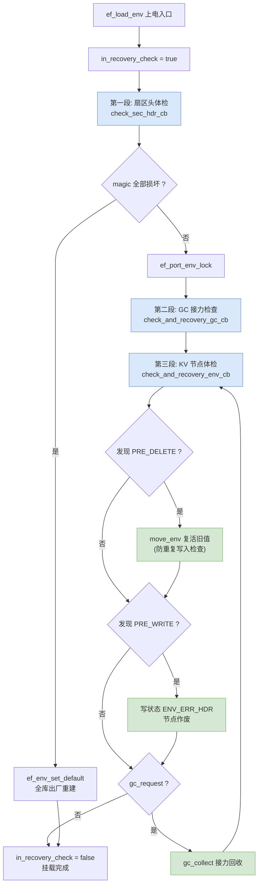
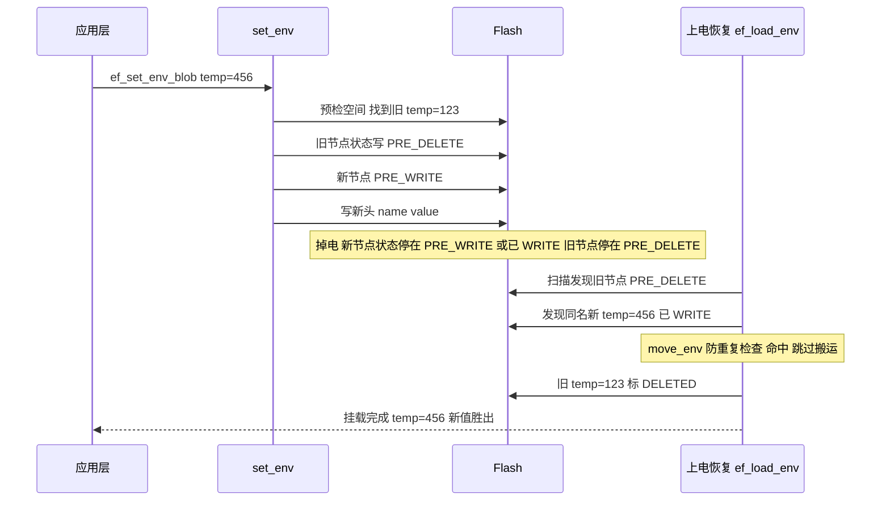
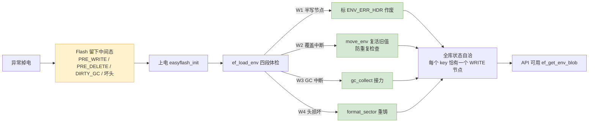

# EasyFlash 源码详解 04：掉电安全与恢复

> **涉及文件**
> - `/easyflash/src/ef_env.c`（NG 模式恢复主线：`ef_load_env` L1763、三个 recovery 回调 L1710-1756、`move_env` L1144）
> - `/easyflash/inc/ef_def.h`（`enum env_status` 状态机，注释后 L122）
> - `/easyflash/src/ef_env_legacy.c`（legacy-PFS 双区仲裁，注释后 `ef_load_env` L827）

掉电安全的本质问题：**写 Flash 不是原子的**。一条 KV 要写 24B 头 + name + value + 状态表，擦扇区要数毫秒——任何一步都可能被掉电切断。EasyFlash 的答案是"**追加写 + 状态门闩 + 上电体检**"三层防线：写入前先立"未完成"标志，写完才换成"有效"标志；上电后逐项体检，发现半成品就地处理。

---

## 1. 四类掉电窗口与对应的自愈动作

| # | 掉电时刻 | Flash 上留下的现场 | 上电自愈动作 | 数据损失 |
| --- | --- | --- | --- | --- |
| W1 | 写新节点中途（状态=PRE_WRITE，头/数据残缺） | 半个节点 | `check_and_recovery_env_cb` 把状态改写 **ENV_ERR_HDR** 作废 | 本次写丢失，旧值完好 |
| W2 | 同名覆盖：新值已落盘，旧节点停在 PRE_DELETE | 新旧两份同名 KV | 恢复回调对 PRE_DELETE 节点执行 `move_env`——把旧值搬到新位置再标删，**新值胜出**（扫描先见新值） | 无 |
| W3 | GC 中途（扇区 dirty=GC，部分 KV 已搬） | 原扇区 + 散落的新副本 | `check_and_recovery_gc_cb` 发现 GC 标记 → 重启 `gc_collect()` 接着搬、搬完擦 | 无 |
| W4 | 扇区头本身半写（magic 损坏） | 整扇区不可信 | `check_sec_hdr_cb` 直接 `format_sector` 重铸；全坏则 `ef_env_set_default` | 该扇区数据丢失 |

W1~W3 的共同点：**恢复逻辑不依赖任何 RAM 状态，全部证据在 Flash 上**（状态表 + 扇区 dirty 轴），这正是追加写架构的核心优势。

## 2. 上电体检流水线：`ef_load_env`

```c
EfErrCode ef_load_env(void)
{
    EfErrCode result = EF_NO_ERR;
    struct env_node_obj env;
    struct sector_meta_data sector;
    size_t check_failed_count = 0;

    in_recovery_check = true;
    /* check all sector header */
    sector_iterator(&sector, SECTOR_STORE_UNUSED, &check_failed_count, NULL, check_sec_hdr_cb, false);
    /* all sector header check failed */
    if (check_failed_count == SECTOR_NUM) {
        EF_INFO("Warning: All sector header check failed. Set it to default.\n");
        ef_env_set_default();
    }

    /* lock the ENV cache */
    ef_port_env_lock();
    /* check all sector header for recovery GC */
    sector_iterator(&sector, SECTOR_STORE_UNUSED, NULL, NULL, check_and_recovery_gc_cb, false);

__retry:
    /* check all ENV for recovery */
    env_iterator(&env, NULL, NULL, check_and_recovery_env_cb);
    if (gc_request) {
        gc_collect();
        goto __retry;
    }

    in_recovery_check = false;
    ...
}
```

四段体检，顺序有讲究：

1. **扇区头体检**（W4）：magic 不对就地格式化；全库皆坏 → 出厂重建；
2. **GC 接力检查**（W3）：发现 dirty=GC 的扇区，置 `gc_request=true`；
3. **KV 节点体检**（W1/W2）：遍历所有节点，处理 PRE_WRITE 与 PRE_DELETE；
4. **GC 收尾重扫**：恢复过程中若请求了 GC（比如恢复旧值导致空间紧张），`gc_collect` 后**回到 __retry 再体检一遍**——因为 GC 搬运可能制造新的中间态节点。

### 2.1 执行流图



## 3. 两个恢复回调精读

### 3.1 `check_and_recovery_env_cb`（L1735-1756）——W1 与 W2 的处理者

```c
static bool check_and_recovery_env_cb(env_node_obj_t env, void *arg1, void *arg2)
{
    /* recovery the prepare deleted ENV */
    if (env->crc_is_ok && env->status == ENV_PRE_DELETE) {
        EF_INFO("Found an ENV (%.*s) which has changed value failed. Now will recovery it.\n", env->name_len, env->name);
        /* recovery the old ENV */
        if (move_env(env) == EF_NO_ERR) {
            EF_DEBUG("Recovery the ENV successful.\n");
        } else {
            EF_DEBUG("Warning: Moved an ENV (size %d) failed when recovery. Now will GC then retry.\n", env->len);
            return true;
        }
    } else if (env->status == ENV_PRE_WRITE) {
        uint8_t status_table[ENV_STATUS_TABLE_SIZE];
        /* the ENV has not write finish, change the status to error */
        /* ... 原文件此处有 GBK TODO 注释：绘制异常处理的状态转换图，略 ... */
        write_status(env->addr.start, status_table, ENV_STATUS_NUM, ENV_ERR_HDR);
        return true;
    }

    return false;
}
```

两条分支对应两类现场：

- **PRE_DELETE**：覆盖中断。`move_env` 把旧值原样搬进新空间并落定，返回 true 让迭代器短路重来（Flash 内容已变，需重新扫）；
- **PRE_WRITE**：半写。写一格状态表把它打成 ENV_ERR_HDR 作废，成本 1 次小写。

### 3.2 `move_env` 里的防重复机关（L1157-1167）

```c
    if ((env_addr = alloc_env(&sector, env->len)) != FAILED_ADDR) {
        if (in_recovery_check) {
            struct env_node_obj env_bak;
            char name[EF_ENV_NAME_MAX + 1] = { 0 };
            strncpy(name, env->name, env->name_len);
            /* check the ENV in flash is already create success */
            if (find_env_no_cache(name, &env_bak)) {
                /* already create success, don't need to duplicate */
                result = EF_NO_ERR;
                goto __exit;
            }
        }
    } else {
        return EF_ENV_FULL;
    }
```

只有**上电恢复阶段**（`in_recovery_check=true`）才做这个检查：搬一个 PRE_DELETE 节点前，先全库找一遍同名 KV——如果掉电前其实已经搬完了（W2 的后续），Flash 上已有新副本，就跳过搬运直接把旧节点标删。没有这道闸，每次重启都会把恢复过的 KV 再搬一遍。

### 3.3 `check_and_recovery_gc_cb`（L1723-1733）——W3 的接力棒

```c
static bool check_and_recovery_gc_cb(sector_meta_data_t sector, void *arg1, void *arg2)
{
    if (sector->check_ok && sector->status.dirty == SECTOR_DIRTY_GC) {
        /* make sure the GC request flag to true */
        gc_request = true;
        /* resume the GC operate */
        gc_collect();
    }

    return false;
}
```

dirty=GC 是 GC 流程的"进行中"路标（03 篇 do_gc 开头写入）。上电看到它，直接再跑一次 `gc_collect`：未搬完的 KV 继续搬，搬完 `format_sector` 收尾。GC 因此是**幂等可续**的。

---

## 4. 同名覆盖掉电的完整时序

以"set temp：123 → 456，在标删旧值前掉电"为例：



若掉电点更早（新节点还没写好），扫描时新节点是 PRE_WRITE → 被打 ENV_ERR_HDR；旧节点 PRE_DELETE → 被 move_env 复活——**旧值 123 胜出**。两种结果都保证"temp 恒有值"。

## 5. legacy 体系：PFS 双区乒乓的恢复

legacy 模式没有逐节点状态机，掉电安全靠**整个区的两份副本**（`ef_env_legacy.c` 注释后 L827 的 `ef_load_env` PFS 版，摘录 L869-881）：

```c
    if (area0_is_valid && area1_is_valid) {
        ...
        /* the bigger saved count area is valid */
        if ((area0_saved_count > area1_saved_count) || ((area0_saved_count == 0) && (area1_saved_count == 0xFFFFFFFF))) {
            area1_is_valid = false; /* 票3：计数比较，区0 胜出（含回绕特判） */
        } else {
            area0_is_valid = false; /* 票3：区1 胜出 */
        }
    }
```

仲裁规则：先看各自"结束地址游标"合法性，再做 CRC32，最后比 **saved_count**（每次保存 +1 的计数器，等价"版本钟"）。写副本中途掉电 → 那份 CRC 必挂 → 裁判自动选中另一份。`(0, 0xFFFFFFFF)` 特判处理 32 位回绕。

代价对比：

| | NG 逐节点状态机 | legacy-PFS 双区乒乓 |
| --- | --- | --- |
| 掉电恢复粒度 | 单 KV | 整个参数集（回退到上次保存） |
| Flash 代价 | 无额外区 | 参数区 ×2 |
| 保存开销 | 写新节点几字节 | 全量擦写 + 换区 |
| 恢复确定性 | 精确到节点 | "最后一次成功的保存" |

## 6. 恢复数据流



---

## 7. 陷阱与实测建议

1. **恢复不是零成本**：W2 复活要搬一次 KV，W3 接力要搬 + 擦一整扇区。大库 + 频繁掉电的设备（如电表）应把"掉电后首次 set 的耗时预算"放大；
2. `EF_INFO` 会在恢复时打印 `Found an ENV (%.*s) which has changed value failed`——量产日志里出现它说明发生过覆盖中断，属正常自愈，频繁出现则要查供电；
3. **不要在恢复完成前调用 API**：`easyflash_init` 返回成功即代表体检走完，之前调用会得到 `EF_ENV_INIT_FAILED`；
4. legacy-PFS 用户注意：恢复粒度是"整份参数集"，两个区都坏（CRC 双挂）才出厂重置；单区坏丢的是"最近一次未完成的保存"，已确认的保存不丢；
5. 实测掉电恢复的粗暴办法：demo 循环里 `ef_set_env_blob("cnt", &i, 4)` 计数自增 + 每百次硬复位（或用继电器切断 VCC），重启后 `cnt` 应单调不回退——这正是 FlashDB README 同款的压力测试雏形。

下一篇 [05-移植层](05-移植层.md) 讲清楚这套机制对硬件提了哪些要求。
