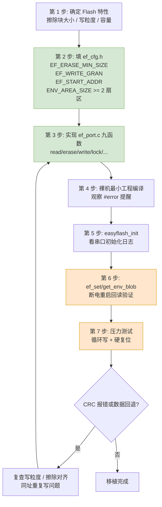
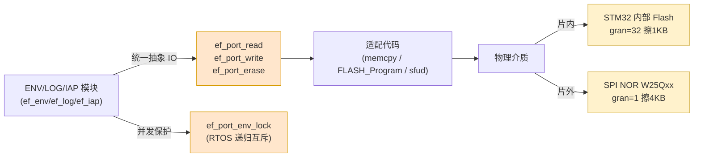

# EasyFlash 源码详解 05：移植层

> **涉及文件**
> - `/easyflash/port/ef_port.c`（移植模板，注释后 219 行，函数位置见下表）
> - `/easyflash/inc/ef_cfg.h`（移植必改的配置宏）
> - `/easyflash/src/easyflash.c`（`easyflash_init` 依赖 `ef_port_init`，见 01 篇）

EasyFlash 官方的移植承诺：**只改 `ef_port.c` 一个文件**。全库对硬件的全部假设都收敛在 9 个函数 + 4 个宏里。本文给出接口契约表、对齐规则的计算方法，以及 STM32 片内 / SPI Flash 两套填空示例。

---

## 1. 移植接口总表（ef_port.c 注释后行号）

| 函数 | 行号 | 职责 | 关键契约 | 返回值 |
| --- | --- | --- | --- | --- |
| `ef_port_init` | L69 | 注册默认 ENV 表 | 只做指针赋值，**不许访问 Flash**；`default_env[i].value_len==0` 按字符串处理 | `EF_NO_ERR` |
| `ef_port_read` | L88 | 读 Flash | `size` 单位字节；库保证已按写粒度对齐；NOR 读无限制 | `EF_NO_ERR`/`EF_READ_ERR` |
| `ef_port_erase` | L108 | 擦除 | `addr` 已保证 `EF_ERASE_MIN_SIZE` 对齐（库内有断言）；**`size` 可能小于一个扇区（legacy-WL 只传 4B），必须向上对齐整扇擦除** | `EF_NO_ERR`/`EF_ERASE_ERR` |
| `ef_port_write` | L131 | 写 Flash | 写前区域必须已擦（全 0xFF）；`size` 按写粒度对齐；**同址禁止重复写**（部分 MCU 多次写会位与） | `EF_NO_ERR`/`EF_WRITE_ERR` |
| `ef_port_env_lock/unlock` | L144/L155 | ENV 临界区 | 多任务必实现（递归互斥量或关调度）；单线程留空 | void |
| `ef_log_debug` | L171 | 调试日志（带文件/行号） | `PRINT_DEBUG` 未定义时库内自动变空宏，可不实现 | void |
| `ef_log_info` | L194 | 运行信息 | 接 `printf` 即可 | void |
| `ef_print` | L210 | 数据打印（ef_print_env 用） | 逐字符输出，别加时间戳前缀 | void |

`ef_port_init` 的签名里藏着默认参数表的传递链（L69）：

```c
EfErrCode ef_port_init(ef_env const **default_env, size_t *default_env_size) {
    EfErrCode result = EF_NO_ERR;

    *default_env = default_env_set;
    *default_env_size = sizeof(default_env_set) / sizeof(default_env_set[0]);

    return result;
}
```

---

## 2. 两个决定一切的宏

### 2.1 `EF_ERASE_MIN_SIZE`：最小擦除粒度

一切"区/扇区"概念的基石。选值 = 目标 Flash 的物理擦除块大小：

| 硬件 | 典型擦除块 | 建议值 |
| --- | --- | --- |
| STM32F1 片内（中容量） | 1 KB | 1024 |
| STM32F4 片内（双 bank） | 16/64/128 KB 不等 | 选最小的均匀块，或外挂 NOR |
| SPI NOR（W25Q64 等） | 4 KB | 4096 |

NG 模式硬性要求 `ENV_AREA_SIZE >= 2 × EF_ERASE_MIN_SIZE`（GC 预备队，01 篇断言 3）。

### 2.2 `EF_WRITE_GRAN`：写粒度（单位 bit）

| 值 | 适用硬件 | 语义 | 对 KV 头大小的影响 |
| --- | --- | --- | --- |
| 1 | 任意 NOR Flash | 可按位写（1→0 自由） | 状态表最省：7 态仅 1 B |
| 8 | STM32F4 片内 | 最小写 1 字节 | 7 态 6 B |
| 32 | STM32F1 片内 | 最小写 4 字节（半页编程） | 7 态 24 B |

计算公式（`ef_env.c` L121-125）：`STATUS_TABLE_SIZE(n) = (n×gran+7)/8`（gran=1）或 `((n-1)×gran+7)/8`（其余）。**选错粒度的症状**：`ef_set_env` 返回写错误或 CRC 永远不过——状态表写坏导致状态解析错乱。

> 与 FlashDB 对照：FlashDB 用同一套 `EF_WRITE_GRAN` 思想（改名 `FDB_WRITE_GRAN`），移植经验可直接迁移。

---

## 3. 地址布局：从 `EF_START_ADDR` 到各模块

```text
EF_START_ADDR
   ├─ [0, ENV_AREA_SIZE)                    ENV 区（NG 或 legacy）
   ├─ [ENV 区尾, +LOG_AREA_SIZE)            日志区（EF_USING_LOG 时）
   └─ [LOG 区尾, ...)                       IAP 备份区（EF_USING_IAP 时）

ef_iap_init 的算术（ef_iap.c 注释后 L61-76 的 ef_iap_init）：
   bak_app_start_addr = EF_START_ADDR
                      + (EF_USING_ENV ? ENV_AREA_SIZE : 0)
                      + (EF_USING_LOG ? LOG_AREA_SIZE : 0)
```

要求：各区大小都是 `EF_ERASE_MIN_SIZE` 整数倍；`EF_START_ADDR` 本身落在真实可擦写的 Flash 区间（避开 App 代码区、参数保留区）。

---

## 4. 移植实施流程



---

## 5. 填空示例

### 5.1 STM32F103 片内 Flash（gran=32）

```c
/* ef_cfg.h */
#define EF_ERASE_MIN_SIZE   1024                    /* 1KB 擦除块 */
#define EF_WRITE_GRAN       32                      /* 半页编程, 最小 4 字节 */
#define EF_START_ADDR       (0x08000000 + 40 * 1024) /* App 之后预留 40KB 起 */
#define ENV_AREA_SIZE       (4 * 1024)              /* 4 扇区 */

/* ef_port.c: ef_port_erase */
EfErrCode ef_port_erase(uint32_t addr, size_t size) {
    EfErrCode result = EF_NO_ERR;
    FLASH_Status flash_status;
    size_t erase_pages, i;

    /* make sure the start address is a multiple of EF_ERASE_MIN_SIZE */
    EF_ASSERT(addr % EF_ERASE_MIN_SIZE == 0);

    /* 【关键】size 可能只有 4B, 必须向上取整到整页擦除 */
    erase_pages = (size + EF_ERASE_MIN_SIZE - 1) / EF_ERASE_MIN_SIZE;
    FLASH_Unlock();
    FLASH_ClearFlag(FLASH_FLAG_BSY | FLASH_FLAG_EOP | FLASH_FLAG_PGERR | FLASH_FLAG_WRPRTERR);
    for (i = 0; i < erase_pages; i++) {
        flash_status = FLASH_ErasePage(addr + i * EF_ERASE_MIN_SIZE);
        if (flash_status != FLASH_COMPLETE) {
            result = EF_ERASE_ERR;
            break;
        }
    }
    FLASH_Lock();

    return result;
}
```

多任务系统（FreeRTOS）的锁：

```c
static SemaphoreHandle_t env_mutex;
void ef_port_env_lock(void)  { xSemaphoreTakeRecursive(env_mutex, portMAX_DELAY); }
void ef_port_env_unlock(void){ xSemaphoreGiveRecursive(env_mutex); }
/* 创建: env_mutex = xSemaphoreCreateRecursiveMutex(); 须在 easyflash_init 之前 */
```

### 5.2 SPI NOR（W25Q64 + SFUD，gran=1）

```c
/* ef_cfg.h */
#define EF_ERASE_MIN_SIZE   4096
#define EF_WRITE_GRAN       1      /* NOR 支持位写, 状态表最省 RAM/Flash */
#define EF_START_ADDR       0      /* 外部 Flash 独占, 从 0 起 */
#define ENV_AREA_SIZE       (16 * 4096)

/* ef_port.c 三个 IO 的典型写法 */
static const sfud_flash *sfud_dev = NULL;

EfErrCode ef_port_init(ef_env const **default_env, size_t *default_env_size) {
    /* 可在此 sfud_init 或延迟到 read 前初始化 */
    ...
}

EfErrCode ef_port_read(uint32_t addr, uint32_t *buf, size_t size) {
    sfud_err err = sfud_read((sfud_flash *)sfud_dev, addr, size, (uint8_t *)buf);
    return err == SFUD_SUCCESS ? EF_NO_ERR : EF_READ_ERR;
}

EfErrCode ef_port_write(uint32_t addr, const uint32_t *buf, size_t size) {
    sfud_err err = sfud_write((sfud_flash *)sfud_dev, addr, size, (const uint8_t *)buf);
    return err == SFUD_SUCCESS ? EF_NO_ERR : EF_WRITE_ERR;
}
```

SFUD 的 page program 内部已处理跨页写，粒度 1 时状态表只有 1 字节，KV 头 24B，容量利用率最高。

---

## 6. 硬件数据流视角



库内所有模块只经由这层抽象触碰硬件，**换 Flash = 换三个函数的实现**，这正是它被移植到几十个平台的原因。

---

## 7. 陷阱与实测建议

1. **erase 的 size 兜底**：库传来的 size 可能是 4B（legacy-WL `save_cur_using_data_addr`）——移植层不做"向上取整到整扇"就会半擦不擦，故障形态是诡异的上电丢参；
2. **同址重复写**：STM32F1 半页编程对已写区域二次编程会整页位与损坏。NG 模式的状态表用"追加一格"写法（`write_status` 只写新格子），天然避免重复写；但**移植层的 write 必须禁止对非 0xFF 区域写入**（可加断言防御）；
3. **读缓冲尺寸**：`EF_READ_BUF_SIZE`（默认 32B）是 `read_env`/`continue_ff_addr` 的栈上缓冲，加大可加快首次扫描但吃栈——裸机小栈建议不动，RTOS 大栈可调 128；
4. **`EF_STR_ENV_VALUE_MAX_SIZE`**（默认 128）约束字符串 API，同时要求 `128*8 % EF_WRITE_GRAN == 0`（01 篇断言 4），改它要注意整除关系；
5. **STM32L4 无法用 NG 模式**（README 官方说明）：片内 Flash 不支持逆序写（状态表必须从高地址格向低地址格推进），这类硬件请用 legacy 模式或外挂 NOR；
6. 移植完成后跑通三件套再上线：`ef_print_env()` 全表打印 → set/get 断电回读 → `ef_get_env_write_bytes()` 观察写入量是否符合预期。

下一篇 [06-API 与实测指南](06-API与实测指南.md) 汇总全部 API 的行为差异与坑点。
