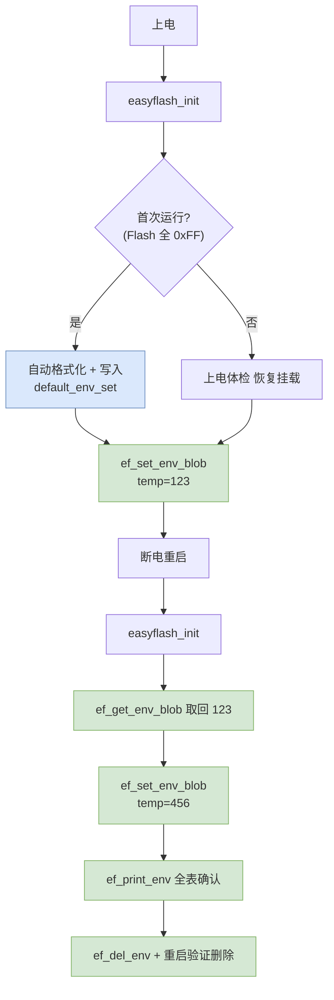
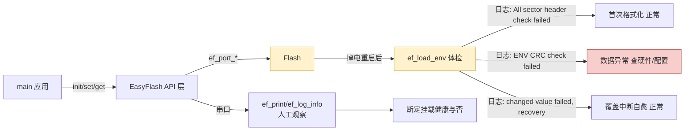

# EasyFlash 源码详解 06：API 与实测指南

> **涉及文件**
> - `/easyflash/inc/easyflash.h`（API 契约总表）
> - `/easyflash/src/easyflash.c`（初始化）
> - `/easyflash/src/ef_env.c`（NG 模式 API 实现）
> - `/easyflash/src/ef_env_legacy.c` / `ef_env_legacy_wl.c`（legacy 模式 API 实现）
> - `/easyflash/plugins/types/ef_types.c`（强类型插件）
> - `/demo/`（各平台实测工程）

---

## 1. API 全表（按使用频率排序）

### 1.1 生命周期

| API | 模式 | 行为 | 坑 |
| --- | --- | --- | --- |
| `easyflash_init()` | 全部 | 整库初始化（ENV→IAP→LOG 串行），幂等 | 之前调用任何 API 返回 `EF_ENV_INIT_FAILED` |

### 1.2 ENV 读写（推荐，NG 模式专属）

| API | 签名要点 | 坑 |
| --- | --- | --- |
| `ef_set_env_blob(key, value_buf, buf_len)` | 任意 blob 即时落盘；同名覆盖两阶段 | 单节点 ≤ 扇区容量-头部 |
| `ef_get_env_blob(key, value_buf, buf_len, &saved_len)` | 返回实际读到的长度；buf 可为 NULL 只查长度 | 截断读不报错，靠 saved_len 区分 |
| `ef_get_env_obj(key, &env)` | 取 KV 元数据对象（RAM 快照） | 之后 Flash 变化不会同步进 obj |
| `ef_read_env_value(&env, buf, len)` | 按对象直读值，省二次查找 | obj 的 CRC 必须有效才读 |

### 1.3 ENV 读写（旧字符串 API，三套模式都提供）

| API | NG 模式行为 | legacy 模式行为 |
| --- | --- | --- |
| `ef_get_env(key)` | 拷入 128B 静态缓冲，要求值可打印 | 返回 RAM 指针（零拷贝） |
| `ef_set_env(key, value)` | 即时落盘 | 只改 RAM（脏标志） |
| `ef_del_env(key)` | 即时标删 | 只改 RAM |
| `ef_save_env()` | **no-op（DEPRECATED）** | 整区擦写落盘（PFS 时换区） |
| `ef_set_and_save_env()` | = `ef_set_env` | set + save 两步 |
| `ef_del_and_save_env()` | = `ef_del_env` | del + save 两步 |
| `ef_env_set_default()` | 格式化全扇区 + 重放默认表 | 同左 |
| `ef_get_env_write_bytes()` | 已用字节统计 | 同左（口径略异） |
| `ef_print_env()` | 遍历打印全部 KV + 统计 | 同左 |
| `ef_load_env()` | 通常不手动调（init 内部已调） | 同左 |

**save 延迟写语义**值得单独强调：legacy 模式的 `ef_set_env` 只改 RAM 镜像（`env_cache_changed=true`），直到 `ef_save_env` 才整区擦写——省擦写但要记得保存；NG 模式把这个两段式**压缩成一步**（写 KV 即落盘），所以 `ef_save_env` 变成空函数。老代码从 V3 升到 V4 无需改动，行为自动升级为即时写。

### 1.4 IAP（`EF_USING_IAP`）

| API | 用途 |
| --- | --- |
| `ef_erase_bak_app(app_size)` | 清备份区 |
| `ef_write_data_to_bak(data, size, &cur_size, total_size)` | 分包下载固件到备份区（cur_size 出入参接力断点） |
| `ef_copy_app_from_bak(user_app_addr, app_size)` | 备份区 → App 区（128B 栈缓冲搬运） |
| `ef_erase_user_app` / `ef_erase_spec_user_app` | 擦 App 区（spec 版支持自定义擦除回调） |
| `ef_copy_bl_from_bak` / `ef_erase_bl` | Bootloader 同理 |
| `ef_get_bak_app_start_addr()` | 查备份区首址（= 区首 + ENV 区 + LOG 区） |

注意：**CRC32 校验固件包要自己做**（`ef_calc_crc32` 现成可用），库只负责搬运。

### 1.5 Log（`EF_USING_LOG`）

| API | 行为 | 坑 |
| --- | --- | --- |
| `ef_log_write(log, size)` | 追加到环形区，写满自动覆盖最旧扇区 | size 必须 4 字节对齐 |
| `ef_log_read(index, log, size)` | index 0 = 最旧日志；size 4 对齐；越界自动截断 | 跨"回卷点"的读取内部自动分段 |
| `ef_log_get_used_size()` / `get_total_size()` | 统计（不含扇区头 12B/个） | - |
| `ef_log_clean()` | 整区格式化 | 不可恢复 |

### 1.6 types 插件（可选编译）

`ef_set_int/ef_get_float/ef_set_struct/...`：字符串 ENV 的强类型壳；数组/结构体走 cJSON 序列化。依赖 cJSON，且受 128B 字符串上限约束——大结构体请直接 `ef_set_env_blob` 存内存镜像。

---

## 2. 实测执行流：从零跑通一次参数存取



最小代码骨架（NG 模式）：

```c
#include <easyflash.h>

/* ef_port.c 里的默认参数表 */
static const ef_env default_env_set[] = {
    {"temp", "25", 0},          /* value_len=0: 按字符串 */
};

int main(void) {
    easyflash_init();                          /* 挂载+体检 */
    ef_set_env_blob("boot_cnt", &cnt, 4);      /* 写 blob */
    uint32_t v = 0;
    ef_get_env_blob("boot_cnt", &v, 4, NULL);  /* 读回 */
    ef_print_env();                            /* 串口全表 */
}
```

## 3. `ef_print_env` 输出解读

```text
temp=25
wifi_ssid=my-wifi
boot_cnt=<blob @0x08004120 4bytes>     ← 二进制值打印地址与长度
mode: next generation
size: 132/8160 bytes.                  ← 已用/可用(扣除 GC 预备队扇区)
```

- NG 模式 `size` 分母 = `ENV_AREA_SIZE - 1 扇区`（预备队不计入可用）；
- legacy 模式还会打印 `write bytes`、`saved count`（PFS）、`ver num`（自动升级）；
- 同名 key 打印多次 = 出现了未回收垃圾（正常，等 GC）或恢复中断（04 篇 W2）。

## 4. 实测数据流



---

## 5. 坑点清单（血泪浓缩）

1. **`ef_get_env` 返回指针的生命周期**：legacy 模式指向 RAM 镜像，下一次 set/del 即失效；NG 模式指向 128B 静态缓冲，**非可重入**（原注释明说 NOT supported reentrant）。多任务请全程持锁或改用 blob API；
2. **首次 init 的"格式化"是正常流程**：全新芯片全 0xFF，体检判为未初始化自动写默认表——串口看到 `All sector header check failed` 不必惊慌；
3. **`EF_ENV_NAME_MAX=32`**：key 超 31 字符返回 `EF_ENV_NAME_ERR`；**key 含 `=`** 在 legacy 体系会污染 `key=value` 协议；
4. **值截断静默**：`ef_get_env_blob` 的 buf 太小只截断不报错，务必核对返回值/`saved_value_len`；
5. **NG 模式 GC 抖动**：写满一个扇区后的那次 set 会附带一次 GC（同步阻塞可达数百毫秒），实时任务要有时间预算或提前预热写入；
6. **`ef_set_and_save_env` 的时代错位**：legacy 时代它是"set+落盘"，NG 时代退化为别名——看到老代码里显式 save 不必等价翻译；
7. **静态局部变量**：`set_env` 的 `env/sector`、`ef_get_env` 的 value 缓冲都是 static，**中断上下文里调用 ENV API 是禁区**（会撕碎状态）；
8. **`ENV_AREA_SIZE` 宁大勿小**：GC 需要 1 个空扇区（硬性），加上 wear 考虑建议 ≥ 4 扇区；区太小会让 GC 频繁搬运同一批热点 KV，加速磨损；
9. **兼容 API 的静默行为差异**：`ef_save_env` 在 NG 返回成功但不做任何事——拿返回值判断"已保存"的旧代码会误判；
10. **Demo 工程按板卡选**：`demo/env/stm32f10x`（Keil 工程）对应 F103，SPI Flash 板选 `demo/env` 下的 SFUD 版本；换板只动 `ef_port.c` 与 `ef_cfg.h`（05 篇流程）。

---

## 6. 常见错误码速查与处置

`EfErrCode`（ef_def.h）七个非零值在现场的典型成因与第一处置：

| 错误码 | 值 | 典型成因 | 处置 |
| --- | --- | --- | --- |
| `EF_ERASE_ERR` | 1 | erase 的 addr/size 未对齐、写保护、坏块 | 核对 `EF_ERASE_MIN_SIZE`；检查移植层是否做整扇向上取整 |
| `EF_READ_ERR` | 2 | SPI Flash 通信故障、地址越区 | 查接线/片选/波特率；确认地址在分区内 |
| `EF_WRITE_ERR` | 3 | 写前未擦、写粒度不符、同址重写 | 确认 erase 先行；核对 `EF_WRITE_GRAN` |
| `EF_ENV_NAME_ERR` | 4 | key 为空/超 31 字符（legacy 含含 '='） | 打印 key 长度排查 |
| `EF_ENV_NAME_EXIST` | 5 | legacy 的 create 撞名（NG 不会返回它） | 改用 `ef_set_env` 覆盖语义 |
| `EF_ENV_FULL` | 6 | legacy：RAM 缓存满；NG：单节点超扇区容量或 GC 后仍无空间 | legacy 扩 `ENV_USER_SETTING_SIZE`；NG 检查 value 长度与扇区容量 |
| `EF_ENV_INIT_FAILED` | 7 | init 未完成/失败即调 API | 确保 `easyflash_init` 返回成功后再用 |

### 1.6.1 types 插件实测示例（可选启用后）

```c
#include <ef_types.h>          /* 需把 plugins/types 加入头文件搜索路径 */

ef_types_init(NULL);           /* 用 libc malloc/free（自实现内存池则传钩子） */
ef_set_int("sample_rate", 16000);
int sr = ef_get_int("sample_rate");

float gains[3] = {0.5f, 1.0f, 2.0f};
ef_set_float_array("gains", gains, 3);   /* Flash 上是 "[0.5,1,2]" 的 JSON 文本 */

struct wifi_cfg cfg = { .ssid = "my-wifi", .ch = 6 };
ef_set_struct("wifi", &cfg, wifi_struct_to_json);   /* struct2json 回调 */
struct wifi_cfg *p = ef_get_struct("wifi", json_to_wifi_struct);
/* ... 使用 p ... */
s2jHook.free_fn(p);            /* 必须手动释放（KB: ef_types.md 陷阱 1） */
```

实测注意：数组/结构体的 JSON 文本受 128B 字符串上限约束（`ef_get_env` 截断），字段多时优先 `ef_set_env_blob` 直存内存镜像。

## 7. 实测验收清单

- [ ] `easyflash_init` 返回 `EF_NO_ERR`，串口打印版本号；
- [ ] 首次运行后 `ef_print_env` 能看到全部默认 KV；
- [ ] set blob → 断电 → 重启 → get 一致（含 4 字节对齐的长度）；
- [ ] 覆盖写 1000 次后 `ef_get_env_write_bytes` 增长符合"追加写"预期（约每次数十字节，而非整区）；
- [ ] `ef_del_env` + 重启后 key 不存在；
- [ ] （进阶）循环计数 + 硬复位压力测试：计数单调不回退（04 篇 W1/W2 场景全经历一遍）。

至此 EasyFlash 六篇正文完结。回到 [00-总览与双模式架构](00-总览与双模式架构.md) 可查看与 FlashDB 的演进对照，或进入知识库逐文件精读各源码条目。
